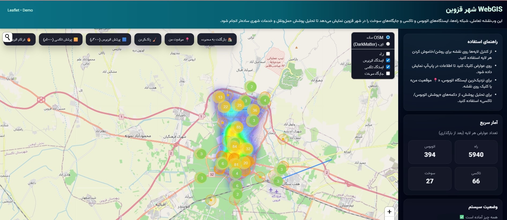

# سامانه WebGIS پشتیبان تصمیم‌گیری شهری قزوین

یک نمونه اولیه مبتنی بر Django برای مشاهده و بررسی مجموعه‌ای از داده‌های
شهری قزوین. این سامانه لایه‌های اطلاعات شهری، جست‌وجوی محلات، ابزارهای ساده
تحلیل مکانی، نمایش نقشه و تهیه گزارش Excel را در یک محیط تحت وب یکپارچه می‌کند.

[English documentation](README.md)



## قابلیت‌ها

- نقشه تعاملی مبتنی بر Leaflet و لایه‌های اطلاعاتی قابل روشن و خاموش کردن.
- نمایش شبکه معابر، ایستگاه‌های حمل‌ونقل عمومی، جایگاه‌های سوخت، مراکز درمانی،
  کاربری اراضی، مرز محلات و گزارش‌های مسائل شهری.
- جست‌وجو و پیمایش محدوده‌های محلات.
- ابزارهای ساده بافر، تراکم نقاط و نزدیک‌ترین ایستگاه.
- بررسی سناریوهای مبتنی بر قواعد از پیش تعریف‌شده و ویژگی‌های موجود داده‌ها.
- نمودارهای خلاصه از داده‌های همراه پروژه.
- خروجی Excel برای یک لایه یا کل مجموعه داده‌ها.
- API مبتنی بر Django برای ارائه داده‌های مجاز و ساخت گزارش‌ها.

> **محدودیت تفسیر و مدل‌سازی:** این مخزن یک نمونه اولیه پشتیبان تصمیم‌گیری است،
> نه یک سامانه پیش‌بینی شهری اعتبارسنجی‌شده. محاسبه نزدیک‌ترین ایستگاه بر اساس
> فاصله مستقیم است، نه مسیر شبکه معابر. بافرها نشان‌دهنده مجاورت هندسی هستند و
> معادل دسترسی واقعی پیاده یا پوشش جمعیت نیستند. نقشه‌های حرارتی صرفاً توزیع
> رکوردهای موجود را نشان می‌دهند و رابطه علت و معلولی را اثبات نمی‌کنند.
> امتیازهای سناریو شاخص‌های قاعده‌محور هستند و نباید به‌عنوان ریسک اندازه‌گیری‌شده،
> پیش‌بینی یا اولویت رسمی مدیریت شهری تفسیر شوند.

## فناوری‌ها

| لایه | فناوری |
|---|---|
| Backend | Python و Django |
| Frontend | HTML، CSS و JavaScript |
| نقشه | Leaflet و کاشی‌های OpenStreetMap |
| داده مکانی | GeoJSON و JSON |
| ابزارهای مکانی سمت مرورگر | Turf.js، Leaflet.heat و Leaflet.markercluster |
| گزارش | openpyxl |
| پایگاه داده محلی | SQLite |
| کنترل کیفیت | تست‌های Django، Ruff و GitHub Actions |

## معماری پروژه

ساختار Django عمداً کوچک نگه داشته شده است. مدیریت درخواست‌های HTTP در
`webgis/views.py` قرار دارد؛ دسترسی به فایل‌های داده از طریق فهرست مجاز در
`webgis/services/datasets.py` انجام می‌شود و تولید فایل Excel در ماژول مستقل
`webgis/services/excel_export.py` قرار گرفته است. فایل‌های منبع Frontend در
مسیر `webgis/static/webgis/js/src/` نگهداری و هنگام ساخت به یک فایل ثابت تبدیل
می‌شوند. اجرای کد JavaScript پویا در زمان اجرا موردنیاز نیست.

برای جزئیات بیشتر، [مستند معماری](docs/ARCHITECTURE.md) را ببینید.

## راه‌اندازی در ویندوز

۱. مخزن را Clone یا فایل آن را استخراج کنید.
۲. وارد پوشه اصلی پروژه شوید.
۳. فایل `run_windows.bat` را اجرا کنید.
۴. نشانی <http://127.0.0.1:8000/> را در مرورگر باز کنید.

فایل اجرا در صورت نیاز محیط مجازی Python را می‌سازد، فایل `.env` محلی را با
کلید توسعه تصادفی آماده می‌کند، وابستگی‌ها را نصب می‌کند، تنظیمات Django را
بررسی می‌کند، Migrationها را اجرا می‌کند و سرور توسعه را بالا می‌آورد.

### راه‌اندازی دستی در PowerShell

```powershell
py -3.12 -m venv .venv
.\.venv\Scripts\python.exe -m pip install --upgrade pip
.\.venv\Scripts\python.exe -m pip install -r requirements.txt
.\.venv\Scripts\python.exe scripts\init_local_env.py
.\.venv\Scripts\python.exe manage.py check
.\.venv\Scripts\python.exe manage.py migrate
.\.venv\Scripts\python.exe manage.py runserver
```

اگر محیط مجازی خراب شده یا با نسخه دیگری از Python ساخته شده است، فایل
`reset_env_windows.bat` را اجرا کنید. این فایل فقط `.venv` را بازسازی می‌کند و
فایل‌های `.env` و `db.sqlite3` را نگه می‌دارد.

### راه‌اندازی در Linux و macOS

```bash
python3 -m venv .venv
. .venv/bin/activate
python -m pip install --upgrade pip
python -m pip install -r requirements.txt
python scripts/init_local_env.py
python manage.py check
python manage.py migrate
python manage.py runserver
```

## توسعه Frontend

فایل‌های منبع را در `webgis/static/webgis/js/src/` ویرایش کنید و سپس از ریشه
پروژه دستور زیر را اجرا کنید:

```bash
node scripts/build_frontend.mjs
```

این اسکریپت ماژول‌ها را بررسی و Bundle ثابت را تولید می‌کند. فایل تولیدشده در
`webgis/static/webgis/js/app.bundle.js` را مستقیماً ویرایش نکنید. Bundle جدید
از `eval` و `new Function` در زمان اجرای مرورگر استفاده نمی‌کند.

## مسیرهای API

| روش | مسیر | کاربرد |
|---|---|---|
| GET | `/` | رابط اصلی WebGIS |
| GET | `/health/` | بررسی وضعیت سرویس |
| GET | `/api/data/<dataset>/` | ارائه لایه JSON یا GeoJSON از فهرست مجاز |
| GET | `/api/export/excel/?dataset=all` | خروجی Excel از همه داده‌ها |
| GET | `/api/export/excel/?dataset=problems` | خروجی Excel از یک لایه |

کلید داده در برابر فهرست مجاز سمت سرور بررسی می‌شود و ورودی کاربر به‌عنوان
مسیر دلخواه فایل‌سیستم استفاده نمی‌شود.

## تست و کنترل کیفیت

برای نصب وابستگی‌های توسعه و اجرای بررسی‌ها:

```bash
python -m pip install -r requirements-dev.txt
python manage.py check
python manage.py test --verbosity 2
ruff check config webgis scripts manage.py
npm run build
npm run check
```

تست‌ها رندر صفحه و ترتیب بارگذاری فایل‌های Frontend، سلامت سرویس، محدودیت
فهرست داده‌ها، پاسخ JSON/GeoJSON، محدودیت روش HTTP، تولید فایل Excel و کاهش
خطر Formula Injection را پوشش می‌دهند. GitHub Actions نیز تست‌های Backend و
ساخت و بررسی نحوی Frontend را هنگام Push و Pull Request اجرا می‌کند. در ویندوز
می‌توانید از `test_windows.bat` برای اجرای کنترل‌های کیفیت استفاده کنید.

## تنظیمات

تنظیمات محلی از متغیرهای محیطی و فایل `.env` خوانده می‌شوند:

| متغیر | کاربرد |
|---|---|
| `DJANGO_SECRET_KEY` | کلید محرمانه الزامی Django |
| `DJANGO_DEBUG` | فعال یا غیرفعال کردن حالت اشکال‌زدایی |
| `DJANGO_ALLOWED_HOSTS` | فهرست میزبان‌های مجاز |
| `DJANGO_CSRF_TRUSTED_ORIGINS` | مبدأهای مورد اعتماد CSRF |
| `DJANGO_SECURE_SSL_REDIRECT` | اجبار انتقال به HTTPS |
| `DJANGO_SECURE_HSTS_SECONDS` | مدت HSTS در حالت غیر Debug |

از `.env.example` به‌عنوان الگو استفاده کنید و هرگز فایل واقعی `.env` را در
مخزن قرار ندهید. پیش از استقرار عملیاتی، `DJANGO_DEBUG=0` تنظیم کنید، کلید
محرمانه منحصربه‌فرد بسازید، میزبان‌ها را محدود کنید، HTTPS را فعال کنید و
چک‌لیست استقرار Django را متناسب با میزبان مقصد بررسی کنید.

## منشأ داده‌ها و مجوز بازنشر

فهرست داده‌ها در [DATA_SOURCES.md](DATA_SOURCES.md) آمده است. پروژه اولیه برای
تمام لایه‌ها اطلاعات کامل منشأ و مجوز بازنشر را ارائه نکرده است؛ بنابراین این
موارد به‌صراحت نیازمند بررسی مسئول مخزن علامت‌گذاری شده‌اند. پیش از انتشار
عمومی یا بازنشر، مجاز بودن انتشار هر مجموعه داده و تصویر را بررسی و ارجاع
مناسب را اضافه کنید. درج انتساب OpenStreetMap برای نقشه پایه، مجوز سایر داده‌های
موجود در مخزن را مشخص نمی‌کند.

## وضعیت پروژه

این پروژه یک نمونه اولیه پژوهشی و قابل ارائه در پورتفولیو است. خروجی‌های آن
باید پیش از استفاده عملیاتی یا تصمیم‌گیری عمومی توسط تحلیل‌گران واجد صلاحیت
بررسی شوند. استقرار Production، بازبینی رسمی امنیت و اعتبارسنجی مستقل داده‌ها
خارج از دامنه این نسخه هستند.
